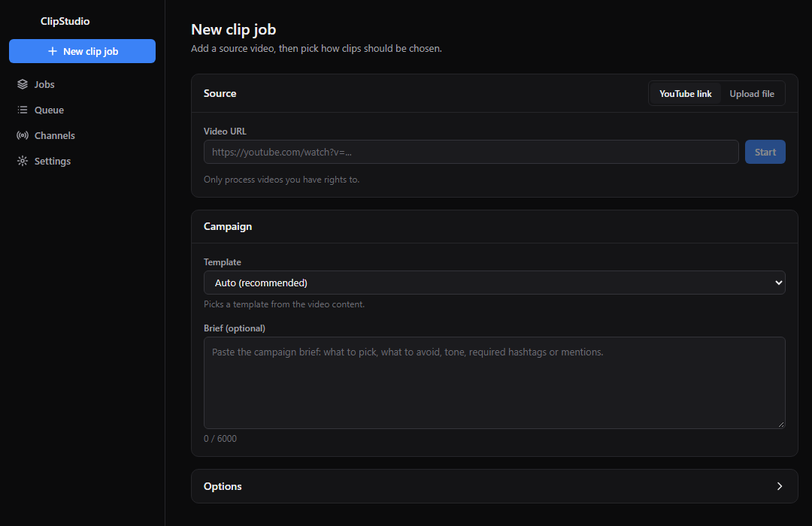
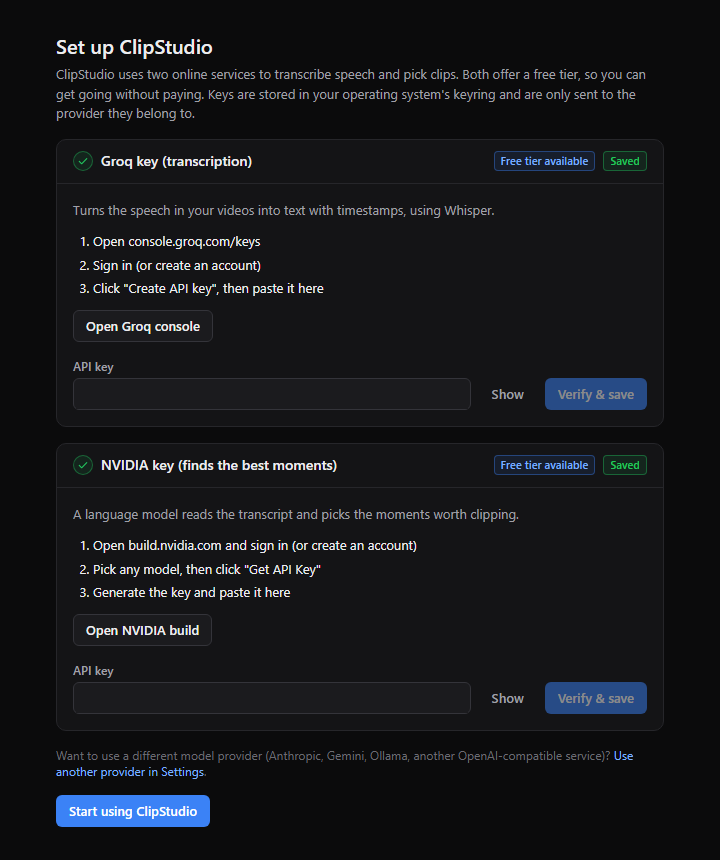

<div align="center">


# ClipStudio

**Turn long videos into ready-to-post Shorts, Reels and TikToks.**

Paste a link or drop a file. ClipStudio finds the moments that tell a complete story,
cuts them, frames them vertically, adds captions and a hook, and writes the title,
description and hashtags for you.

[](https://github.com/Shamilx/clipstudio/actions/workflows/ci.yml)
[](LICENSE)


[Features](#features) ·
[Quick start](#quick-start) ·
[Free API keys](#free-api-keys) ·
[How it works](#how-it-works) ·
[Campaigns](#campaign-briefs) ·
[Troubleshooting](#troubleshooting)

</div>

---

<p align="center">
  
</p>

## Why ClipStudio

- **Stories, not fragments.** Clips are chosen as complete mini stories, with a hook, context,
  development and a payoff, so a viewer with zero context still gets it.
- **Runs on a modest PC.** A 4-core CPU is enough and no GPU is needed. Transcription and
  clip selection run on hosted services with free tiers. Only light video work happens locally.
- **Free to start.** Two free API keys (Groq and NVIDIA) are all you need. A setup screen walks
  you through getting them on first launch.
- **Made for clipping campaigns.** Paste a campaign brief and ClipStudio follows it: what to
  pick, what to avoid, required hashtags and tags, tone of hooks and captions.
- **You stay in control.** Review every clip, trim it on word boundaries, edit captions and
  metadata, then export.

## Features

| | |
|---|---|
| **Ingest** | YouTube links (via yt-dlp) or uploaded files: mp4, mov, mkv, webm, mp3, wav, m4a |
| **Transcription** | Word-level timings with Groq-hosted Whisper, or a local faster-whisper model |
| **Clip selection** | An LLM picks complete stories and scores them; a light heuristic is blended in |
| **Reframing** | Shot detection, face tracking and active-speaker selection for 9:16, 1:1 and 16:9 |
| **Captions** | Bold Yellow, Box, Karaoke, One Word, Clean and Film styles, full Unicode support |
| **Hooks** | An on-screen hook card for the first seconds, written for each clip |
| **Auto-edit** | Silence cutting, filler-word removal, punch-in zooms, keyword emphasis, progress bar, loudness normalisation, optional background music |
| **Already subtitled footage** | Turn off *Burn captions* to keep the video's own subtitles; the hook card stays |
| **Review** | Approve / reject with reasons, word-snapping trim handles, caption editor, live preview |
| **Metadata** | Title, description and hashtags per clip, with one-click copy |
| **Quality check** | Automatic QA of the rendered frames (framing, captions, brand visibility) |
| **Batch work** | Job queue and channel watching for new uploads |
| **Resumable** | Every stage is saved per job, so a retry continues where it failed |

**LLM providers:** NVIDIA build (default), any OpenAI-compatible endpoint (OpenRouter, Groq,
DeepSeek, LM Studio, ...), Anthropic, Google Gemini and Ollama (fully local).

## Quick start

### Windows

1. Install **Node.js 20+** from [nodejs.org](https://nodejs.org) and **ffmpeg**:
   ```powershell
   winget install Gyan.FFmpeg
   ```
2. Download or clone this repository, then double-click **`setup.bat`**. It installs
   Python 3.12 (via [uv](https://github.com/astral-sh/uv)), the Python packages, and builds
   the web interface.
3. Double-click **`start.bat`** and open <http://127.0.0.1:8010>. Close the console window to
   stop the server.
4. On first launch the **Set up ClipStudio** screen asks for your two free API keys and checks
   them. No config files to edit.

### macOS / Linux

Requirements: Python 3.11 or 3.12 (MediaPipe has no wheels for 3.13 yet), Node.js 20+, and
ffmpeg built with libass.

```bash
git clone https://github.com/Shamilx/clipstudio.git
cd clipstudio
uv venv --python 3.12              # or: python3.12 -m venv .venv
uv pip install -e .                # or: .venv/bin/pip install -e .
(cd frontend && npm ci && npm run build)
.venv/bin/clipstudio doctor        # checks ffmpeg, GPU and dependencies
.venv/bin/clipstudio serve --open
```

### Docker

```bash
docker compose -f docker/compose.yaml up --build
```

## Free API keys



ClipStudio needs two keys. Both providers offer a free tier (limits and terms are set by the
providers and may change).

| Key | Used for | Get it |
|---|---|---|
| **Groq** | Speech-to-text (Whisper) | [console.groq.com/keys](https://console.groq.com/keys) |
| **NVIDIA build** | Clip selection and visual checks | [build.nvidia.com](https://build.nvidia.com) |

Paste them into the setup screen on first launch. Each key is verified with a quick request and
stored in your operating system's keyring; it is only ever sent to the provider it belongs to.

You can also use a `.env` file in the project folder:

```
GROQ_API_KEY=...
NVIDIA_API_KEY=...
```

or the command line: `clipstudio config set-secret groq` (also `nvidia`, `anthropic`,
`openai`, `gemini`).

Prefer another model? Open **Settings → Provider & models** and pick Anthropic, Gemini, any
OpenAI-compatible endpoint, or Ollama (local, no key).

<br clear="right" />

## Usage

1. Click **New clip job** and paste a YouTube link, or switch to **Upload file**.
2. Optionally pick a **template** and paste a **campaign brief**.
3. Open **Options** to change caption style, aspect ratio, clip length, number of clips and the
   auto-edit switches.
4. Press **Start** and follow the progress: prepare, transcribe, highlights, reframe, captions,
   export, QA.
5. In **Review**, go through the clips: play the live preview, trim, edit captions, approve or
   reject (keyboard: `J`/`K` next and previous, `A` approve, `X` reject).
6. Copy the title, description and hashtags, and download the mp4.

Need more? **Generate more** asks for additional clips while avoiding the ones you already have
and learning from the ones you rejected.

> Only process videos you own or have the rights to use.

## How it works

```
 video / link
     │
     ▼
 1. Prepare      audio extraction, silence map, thumbnails
 2. Transcribe   word-level timings (Groq Whisper or local)
 3. Highlights   LLM reads the transcript (+ on-screen descriptions) and returns
                 complete stories with hook, title, description and hashtags
 4. Reframe      shot detection → face tracking → active speaker → smooth crop path
 5. Captions     ASS subtitles in the chosen style, hook card, keyword emphasis
 6. Export       one ffmpeg pass: crop, zooms, captions, overlays, loudness
 7. QA           frame checks for framing, caption safety and brand visibility
     │
     ▼
 vertical clips + title / description / hashtags
```

Each stage writes its result to the job's folder, so a failed or cancelled job resumes at the
stage that stopped. See [docs/ARCHITECTURE.md](docs/ARCHITECTURE.md) for details.

### How clips are chosen

The model is instructed to return **complete stories**, never fragments: every clip opens on a
hook, makes clear who is involved and what is happening, develops, and ends on a payoff (a
reveal, punchline, reaction, conclusion or deliberate cliffhanger). Setups are kept together with
their payoffs. Short videos, only a little longer than one clip, are treated as one story told
from different angles. Candidates are deduplicated, snapped to sentence boundaries and ranked;
the top clips are always kept and the rest only above the quality threshold.

## Campaign briefs

Clipping a sponsored or campaign video? Paste the brief into the **Brief** field. ClipStudio
extracts the hard rules and applies them through the whole pipeline:

- what to pick and what to avoid (for example "no announcements", "product must be visible"),
- required hashtags and caption lines, added to every clip's metadata,
- hook and caption tone,
- footage type (film, talking, event, gaming), which tunes framing and captions.

Templates (**Settings → Templates**) save a look: caption preset, colours, hook card, zoom
strength, progress bar, required hashtags and watermark text.

## Configuration

Everything is in **Settings** and can be overridden per job.

| Option | What it does |
|---|---|
| Cut silences | Shortens long pauses |
| Remove fillers | Cuts "um", "uh" and similar |
| Punch-in zooms | Zooms on key moments and cuts |
| Highlight key words | Numbers and key words in colour |
| Progress bar | Thin bar along the top |
| Normalize loudness | Targets about -14 LUFS |
| Background music | A royalty-free track from `music/`, ducked under speech (off by default) |
| Burn captions | Off for footage that already has subtitles (the hook card stays) |

Defaults are tuned for light machines: 720×1280 output, libx264 `veryfast`, CRF 23, one job at
a time, face detection at 2–3 frames per second.

Data (database, media, exports, settings) lives in `~/.clipstudio`; override it with
`CLIPSTUDIO_HOME`. Other environment variables: `NVIDIA_MODEL`, `NVIDIA_FALLBACK_MODEL`,
`RENDER_THREADS` (caps encoder threads). See [`.env.example`](.env.example).

## Troubleshooting

<details>
<summary><b>YouTube download fails</b> ("Sign in to confirm you're not a bot" or 403)</summary>

1. Update yt-dlp: `clipstudio update-ytdlp`.
2. In **Settings → Ingest**, set *cookies from browser* to `chrome`, `edge` or `firefox`
   (be signed in to YouTube in that browser and close it first).
</details>

<details>
<summary><b>Rate limit (429)</b></summary>

You reached the Groq or NVIDIA free-tier limit. ClipStudio waits and retries automatically. If
it still fails, wait a minute and press **Retry**; finished stages are not repeated.
</details>

<details>
<summary><b>No clips were produced</b></summary>

Lower the minimum clip length in **Options**, or try a larger model in **Settings**. Very short
videos are always returned as at least one clip.
</details>

<details>
<summary><b>Double subtitles</b></summary>

The source video already has burned-in subtitles. Turn off **Burn captions** in **Options**.
</details>

<details>
<summary><b>The computer slows down while rendering</b></summary>

ffmpeg runs at low priority. Set `RENDER_THREADS=4` in `.env` to lighten it further, and turn
off zooms and the progress bar for faster renders.
</details>

<details>
<summary><b>Port already in use</b></summary>

The next free port is chosen automatically (8010 by default), or set `PORT` before `start.bat`.
</details>

For anything else run `clipstudio doctor`; it checks every dependency and explains what to fix.

## Development

```bash
clipstudio serve                    # backend on :8010
cd frontend && npm run dev          # Vite dev server on :5173, proxies /api
.venv/bin/python -m pytest          # tests (Windows: .venv\Scripts\python.exe -m pytest)
cd frontend && npm run build        # type-check and build into backend/clipstudio/static
```

- Backend: FastAPI in [`backend/clipstudio`](backend/clipstudio). Frontend: React, Vite and
  Tailwind in [`frontend`](frontend).
- Prompts live in [`backend/clipstudio/prompts`](backend/clipstudio/prompts) as versioned
  text files.
- Optional local Whisper: `uv pip install -e ".[local-whisper]"`, then
  **Settings → Transcription engine → local**.

Contributions are welcome. Please read [CONTRIBUTING](docs/CONTRIBUTING.md) and the
[Code of Conduct](CODE_OF_CONDUCT.md) first. Security issues: see [SECURITY](SECURITY.md).

## Roadmap

- More caption styles and animated hook cards
- Multi-clip montages (several moments edited into one story)
- Scheduled publishing helpers and per-platform metadata
- Better local-only mode (Whisper + Ollama) for fully offline use

## Non-goals

Posting directly to social platforms and a full timeline editor are out of scope on purpose.
ClipStudio does not and will not circumvent DRM.

## License

[MIT](LICENSE). Bundled fonts, emoji and their licenses are listed in [NOTICE](NOTICE).
